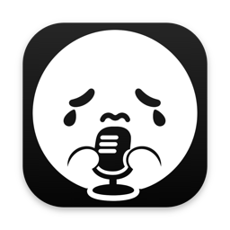
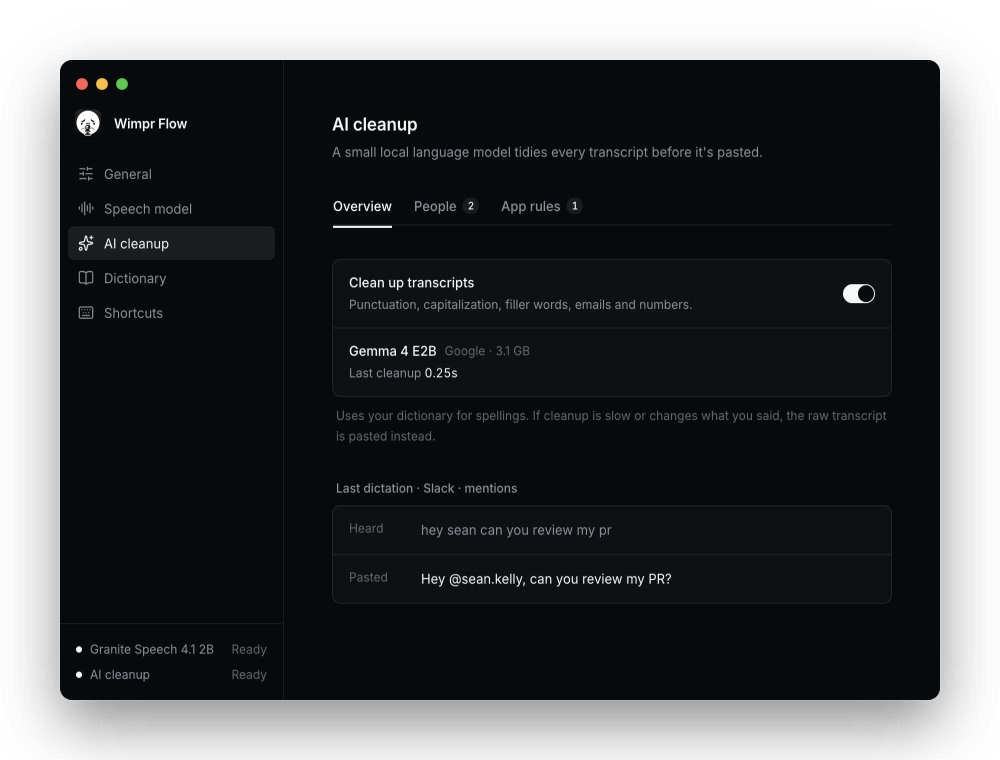
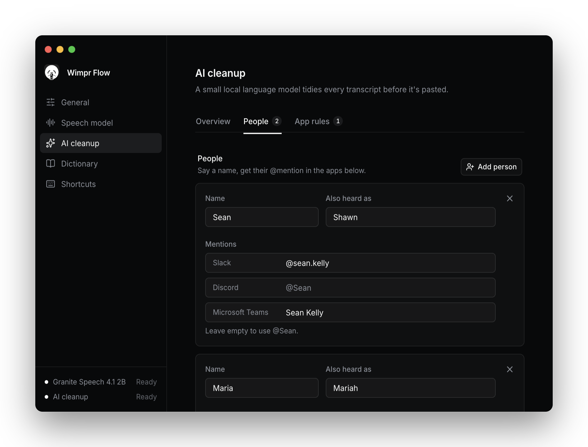
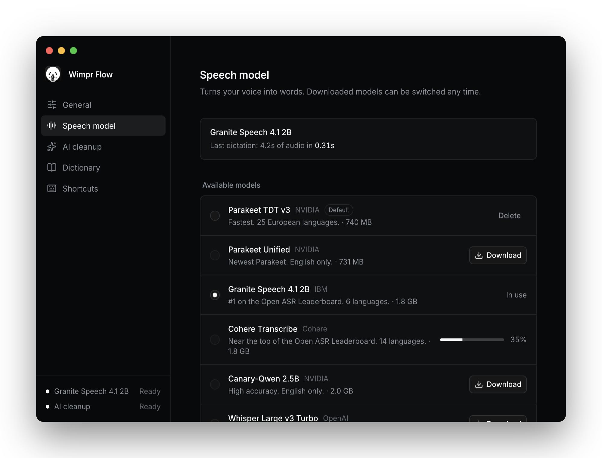

<p align="center">
  
</p>

<h1 align="center">Wimpr Flow</h1>

<p align="center">
  Private voice dictation for macOS, Windows and Linux that runs entirely on your computer.<br>
  Hold a hotkey, talk, let go: your words are pasted into whatever text field has focus.<br>
  Everything Wispr Flow does that matters, nothing it charges for.
</p>

<p align="center">
  <a href="https://github.com/angelplusultra/wimpr-flow/releases/latest"><b>Download</b></a> for Apple Silicon Macs, Windows (x64) and Linux (x64, AppImage or Arch package)
</p>

<p align="center">
  
</p>

- **Fully on-device:** current open speech models (NVIDIA Parakeet, IBM Granite, Cohere, Mistral Voxtral, Qwen3-ASR, Whisper) run on your GPU (Metal on Macs, Vulkan on Windows and Linux) via [transcribe.cpp](https://github.com/handy-computer/transcribe.cpp). No accounts, no API keys, no network after the model download.
- **Fast:** with the default model (Parakeet TDT v3), a few seconds of speech transcribes in well under 0.1 s on an M-series Mac.
- **AI cleanup:** a small local LLM (Gemma 4 E2B) fixes punctuation, drops filler words and writes out emails and numbers. It takes about 0.2–0.4 s for a typical dictation.
- **Hold-to-talk** and **hands-free toggle** hotkeys, both configurable.
- **@mentions:** say "hey sean" in Slack, Discord or Teams and get `@sean.kelly`. App rules add your own instructions per app.
- Pastes at the cursor in any app, then puts your previous clipboard back.
- Lives in the menu bar (the system tray on Windows and Linux).

## Screenshots

<table>
  <tr>
    <td width="50%"></td>
    <td width="50%"></td>
  </tr>
  <tr>
    <td align="center"><sub>People: say a name, get the right @mention in each app</sub></td>
    <td align="center"><sub>Pick a speech model; they download on demand</sub></td>
  </tr>
</table>

<sub>Screenshots use sample data.</sub>

## Quick start

Requires Node 22+ and pnpm, on macOS (Apple Silicon), Windows (x64) or Linux (x64). Linux needs some setup first; see [Linux](#linux-hyprland).

```sh
pnpm install
pnpm dev
```

On first launch:

1. **Grant permissions.** *Microphone* to hear you, *Accessibility* for the global hotkey and for pasting. **In dev (`pnpm dev`), macOS checks the terminal you launched from (Ghostty, iTerm, VS Code…), not Electron.** Enable Accessibility for that terminal, then restart `pnpm dev`. The packaged app asks for itself.
2. **Wait for the models.** The speech model (Parakeet TDT v3, 740 MB) downloads automatically, then the cleanup model (Gemma 4 E2B, 3.1 GB). Progress shows in Settings and in the menu bar. Dictation works as soon as the speech model is ready; until the cleanup model is ready, text is pasted unformatted.
3. Click into any text field, **hold Right ⌥ Option** (Right Alt on Windows and Linux), talk, release.

To build a standalone app run `pnpm dist` on the OS you're building for:

- macOS: `dist/wimpr-flow-<version>-arm64.dmg`, signed with a local certificate (see Code signing).
- Windows: `dist/wimpr-flow-<version>-x64.exe`, an installer. Build it in CI (see Releases) so it includes the VC++ runtime.
- Linux: `dist/wimpr-flow-<version>-x86_64.AppImage` and an Arch package (`.pacman`).

People who install it need nothing else, apart from the Linux setup below.

## Linux (Hyprland)

Tested on Hyprland (Arch, NVIDIA). Other Wayland desktops and X11 should mostly work, but they're untested, and the overlay may take focus away from the field you're dictating into.

1. **Keyboard access.** Wayland doesn't let apps see global key presses, so Wimpr Flow reads the keyboard from `/dev/input`. That needs the `input` group: run `sudo usermod -aG input $USER`, then log out and back in. Any program you run can read your keyboard once you're in this group.
2. **Paste tools and Vulkan.** `sudo pacman -S --needed wl-clipboard wtype vulkan-icd-loader` (the Arch package pulls these in). NVIDIA also needs `nvidia-utils` for Vulkan. Without Vulkan, both models run on the CPU: transcription is still fine, but AI cleanup often runs past its time limit and pastes the raw transcript. Settings shows what each model runs on.
3. **Start it at login.** Hyprland only runs autostart entries through uwsm or dex. Otherwise add `exec-once = wimpr-flow` (or the AppImage's path) to your config.

The voice overlay floats at the bottom of the focused monitor, on every workspace, and never takes focus. Wimpr Flow adds Hyprland window rules for it at startup (through `hyprctl`, without touching your config) and adds them again after every config reload. If that fails, Settings shows the rules to paste into your config. The settings window floats too. In terminals (kitty, foot, Alacritty, Ghostty…) it pastes with Ctrl+Shift+V. In everything else it uses Ctrl+V.

Settings and the tray need a status-bar tray, such as waybar's `tray` module. Without one, launch Wimpr Flow again to open Settings.

## Windows

Install and run; there's no setup. Microphone access is a switch in Settings → Privacy & security → Microphone ("Let desktop apps access your microphone"). The installer isn't code-signed, so SmartScreen warns the first time: choose *More info* → *Run anyway*. Windows doesn't let apps send keys to apps running as administrator, so you can't dictate into those.

## People and @mentions

Settings → AI cleanup → People maps names you say to the @mention each app needs. Dictating "hey sean can you review my pr" into Slack pastes `Hey @sean.kelly, can you review my PR?`, and in Teams `@Sean Kelly, …`.

- **People:** the name you say, other spellings the speech model might produce ("heard as": Shawn), and a handle per app. An empty handle falls back to `@Name`. Names are also added to the speech model's vocabulary.
- **Mention apps:** Slack, Discord and Microsoft Teams by default (on Linux also Vesktop and Teams for Linux); add any running app. Mentions only happen in these apps.
- **Mention people not in your list:** on by default, so anyone you address becomes `@Name`; off means only your list gets mentions.

AI cleanup does the matching, so slight mis-transcriptions still map to the right person. The drift check treats a handle as the spoken name, so long handles aren't mistaken for the model rewriting you. The app in front when you start recording is the one the text goes into, and it's looked up with `lsappinfo` on macOS, the foreground window's executable on Windows, and `hyprctl` on Hyprland.

## App rules

Settings → AI cleanup → App rules adds free-form instructions for AI cleanup in one app, e.g. "Keep it casual, all lowercase" for iMessage. Both people and rules need AI cleanup to be on.

## Models

Pick one in Settings. Models download on demand to `~/Library/Application Support/Wimpr Flow/models` on macOS, `%LOCALAPPDATA%\Wimpr Flow\models` on Windows and `~/.local/share/wimpr-flow/models` on Linux (on macOS, settings and models from the app's earlier names, Fuck Wispr Flow and open-wispr, are moved there on first launch), and you can switch between downloaded ones from the menu bar. These are transcribe.cpp's verified GGUF builds, quantized to the smallest size that matches full-precision accuracy.

| Model | Size | Languages | Notes |
| --- | --- | --- | --- |
| **Parakeet TDT v3** (NVIDIA) — default | 740 MB | 25 European | Fastest by far |
| Parakeet Unified (NVIDIA) | 731 MB | English | Newest Parakeet |
| Granite Speech 4.1 2B (IBM) | 1.8 GB | 6 | #1 on the Open ASR Leaderboard |
| Cohere Transcribe | 1.8 GB | 14 | Near the top of the Open ASR Leaderboard |
| Canary-Qwen 2.5B (NVIDIA) | 2.0 GB | English | |
| Voxtral Mini 3B (Mistral) | 3.0 GB | Many | Strong on conversational speech |
| Qwen3-ASR 1.7B (Alibaba) | 1.5 GB | 30 | |
| Whisper Large v3 Turbo (OpenAI) | 886 MB | 99 | Widest language coverage |

Settings shows how long the last dictation took to transcribe, so you can compare models on your own voice and computer. **Vocabulary hints** (names, jargon) only work on models that support them, and Settings tells you when the current model ignores them. Parakeet, for example, does not.

To add a model, add an entry to `MODEL_CATALOG` in `src/main/models.ts`. Any family transcribe.cpp supports will work.

## AI cleanup

Speech models write down the words you said, but they don't reliably punctuate, and none of them turn "jane at example dot com" into an email address. Some get worse with vocabulary hints: Granite drops punctuation and capitalization in about half of its dictations when a hint is set. So after transcription, the text goes through **Gemma 4 E2B**, running locally through [node-llama-cpp](https://github.com/withcatai/node-llama-cpp). It:

- fixes punctuation, capitalization and sentence breaks
- removes filler words (um, uh) and stutters
- writes emails, URLs, numbers and times the way you'd type them
- uses your vocabulary list for spellings, even with speech models that ignore it

Gemma 4 E2B was picked by testing six current small models (Qwen3.5 0.8B/2B/4B, LFM2.5 1.2B/2.6B, Gemma 4 E2B) on real dictations. It was the only one that formatted every test correctly while staying fast, and it didn't answer questions or follow instructions in the dictated text.

Safeguards, so cleanup can never make a dictation worse than the raw transcript:

- **Time limit.** About 1 s plus 15 ms per word, capped at 3 s. If cleanup runs longer, generation stops and the raw transcript is pasted. In practice that only happens on dictations over roughly 150 words.
- **Drift check.** The cleaned text is compared letter by letter with the transcript, ignoring filler words. If it changed too much (an answer instead of the question, a followed instruction, a ramble), the raw transcript is pasted.
- Settings and the menu bar show how long the last cleanup took and what happened.

Turn it off in Settings → AI cleanup. That unloads the model, and you can then delete it.

## Hotkeys

| Action | Default |
| --- | --- |
| Hold to talk | hold **Right ⌥** (Right Alt) and release to paste |
| Hands-free | **Right ⌥ + Space** to start, **Right ⌥** to stop |
| Cancel | **Esc** |

While you're holding Right ⌥, pressing Space switches to hands-free, so you can let go and keep talking. Both bindings can be changed or turned off in Settings.

Some recordings are thrown away on purpose: very short taps (under 300 ms, adjustable), silent recordings, and cases where you were just using ⌥ as a modifier, like typing ⌥E (or AltGr+E on Windows).

On Windows, letting go of Alt on its own normally opens the app's menu bar. Wimpr Flow taps an unused key while you hold it, so that doesn't happen. On Linux, Firefox may still show its menu bar when you let go. If that bothers you, bind dictation to another key.

## How it works

```
global key hook (uiohook-napi on macOS and Windows, /dev/input on Linux)
  → HotkeyMachine (hold / toggle / latch / cancel)
  → Controller: idle → recording → transcribing → idle
      overlay window (non-focusable panel; floated by window rules on Hyprland) records 16 kHz mono PCM via AudioWorklet
      → Transcriber → Engine → utility process running transcribe.cpp (model stays loaded)
      → Cleaner → CleanupEngine → utility process running Gemma via node-llama-cpp (time limit + drift check)
      → clipboard + simulated ⌘V / Ctrl+V (wl-clipboard + wtype on Wayland) → restore clipboard
```

Both engines run in Electron utility processes, so a native crash can't take the app down. They're restarted on the next dictation. After a model loads, a warm-up run absorbs the one-time GPU setup. For the cleanup model it also caches the fixed part of the prompt, so each dictation only processes its own words.

| Path | What |
| --- | --- |
| `src/main/index.ts` | App lifecycle, tray menu, IPC wiring |
| `src/main/controller.ts` | Dictation state machine: record → transcribe → clean up → paste |
| `src/main/transcriber.ts` | Keeps the selected model downloaded and loaded; status and timings |
| `src/main/engine/` | Transcription worker process manager, the worker itself, per-model option handling |
| `src/main/cleaner.ts` | Keeps the cleanup model loaded; time limit, drift check, status |
| `src/main/cleanup/` | Cleanup worker process manager, the worker, the prompt and drift check (unit tested) |
| `src/main/models.ts` | Model catalog and downloads |
| `src/main/hotkey-machine.ts` | Pure hotkey logic (unit tested) |
| `src/main/hotkey.ts` | Feeds the key hook into the state machine, combo capture |
| `src/main/paste.ts` | Clipboard snapshot, paste, restore |
| `src/main/platform/` | Everything OS-specific: key hook, paste, focused app, permissions, models folder, launch at login. `darwin/`, `win32/` (koffi), `linux/` (evdev worker, Hyprland rules, wl-clipboard/wtype) |
| `src/renderer/overlay/` | Recorder + the little pill UI |
| `src/renderer/settings/` | Settings window (React, Tailwind v4, shadcn/ui components in `src/renderer/components/ui`) |

```sh
pnpm test        # vitest
pnpm typecheck
```

## Troubleshooting

- **Settings still says "Grant" even though Accessibility is turned on.** In dev, the toggle has to be on for your *terminal* app, not "Electron". See Quick start.
- **The hotkey does nothing.** Accessibility isn't granted, or it was granted to a build signed differently (e.g. before the signing certificate was set up, or without it). In System Settings → Privacy & Security → Accessibility, remove the Wimpr Flow (or Electron) entry and grant it again. Or run `tccutil reset Accessibility dev.wimprflow.app` and grant it again.
- **The text was transcribed but never pasted.** No text field had focus. Use **Paste last transcript** or **Copy last transcript** from the menu bar.
- **Fn / Globe key.** The keyboard hook can't see it, so it isn't supported yet.
- **Linux: the hotkey does nothing.** Settings → General shows whether the keyboard can be read. If you just joined the `input` group, log out and back in (a new terminal isn't enough).
- **Hyprland: the overlay tiles or steals focus.** Settings → General shows the window rules if the app couldn't add them. Run `hyprctl clients` while dictating: the "Wimpr Flow overlay" window should be `floating: 1` and `pinned: 1`.
- **Linux: nothing is pasted.** Install `wl-clipboard` and `wtype`.
- **Windows: it crashes on the first dictation.** The VC++ runtime is missing or too old (transcribe.cpp needs 14.40+). Builds from CI include it; for a local build, install the [VC++ Redistributable](https://aka.ms/vs/17/release/vc_redist.x64.exe).

## Roadmap

- Faster cleanup on long dictations (Gemma's multi-token-prediction draft model)
- Spoken commands ("new line", "scratch that")
- Live streaming transcription (Nemotron / Parakeet streaming)
- Transcript history
- Per-app context and custom snippets
- Windows on ARM and Linux on ARM
- Fn key support

## Releases

`.github/workflows/release.yml` builds the Windows installer and the Linux packages on GitHub's runners. Push a `v*` tag to attach them to a draft release, or run the workflow by hand to get them as artifacts. Build macOS locally with `pnpm dist:mac`, since it's signed with a certificate in your keychain.

## Code signing

Builds are signed with a self-signed certificate named **Fuck Wispr Flow Local Signing** in the login keychain (`identity` in `electron-builder.yml`). macOS ties Microphone and Accessibility permissions to that certificate rather than to one exact build, so they survive rebuilds. Other Macs won't trust it; distributing needs an Apple Developer ID.

To recreate the certificate on a new Mac:

```sh
cat > cert.cnf <<'CNF'
[ req ]
distinguished_name = dn
prompt = no
x509_extensions = ext
[ dn ]
CN = Fuck Wispr Flow Local Signing
[ ext ]
basicConstraints = critical, CA:false
keyUsage = critical, digitalSignature
extendedKeyUsage = critical, codeSigning
CNF
openssl req -x509 -newkey rsa:2048 -nodes -days 3650 -config cert.cnf -keyout key.pem -out cert.pem
openssl pkcs12 -export -inkey key.pem -in cert.pem -out cert.p12 -passout pass:temp
security import cert.p12 -k ~/Library/Keychains/login.keychain-db -P temp -T /usr/bin/codesign
security add-trusted-cert -r trustRoot -p codeSign -k ~/Library/Keychains/login.keychain-db cert.pem  # asks for your password
rm key.pem cert.p12 cert.pem cert.cnf
```

On the first build, macOS asks whether codesign may use the key: enter your password and choose **Always Allow**.

## App icon

Every icon comes from one black-on-white image, `build/icon-source.png`:

```sh
pnpm icons
```

That cuts the drawing out of its background and writes:

- `build/icon.png` and `build/icon.icns`: the app icon, with the drawing in white on a dark rounded square sized to the macOS icon grid
- `src/main/tray-images.ts`: menu bar template images, the solid face when idle and its outline while recording. On Windows and Linux they're drawn white at runtime.
- `src/renderer/assets/app-icon.png`: the icon in the settings sidebar

To change the icon, replace `build/icon-source.png` with another dark drawing on a light background and run it again.

## License

MIT
